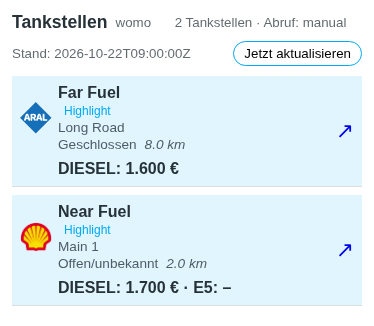
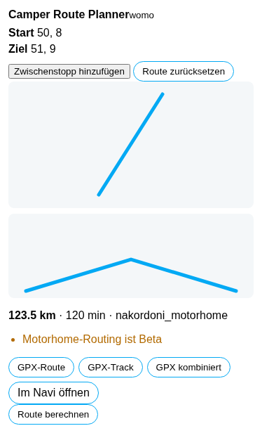
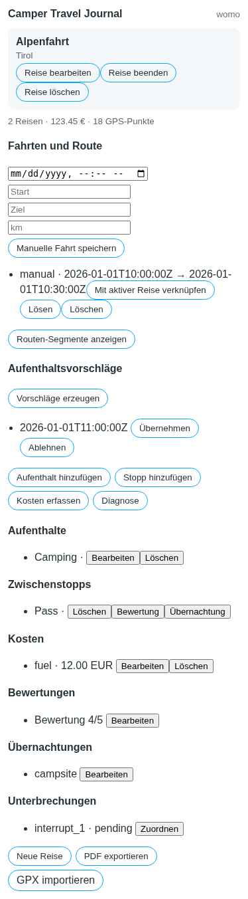
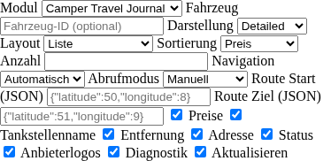

# SmartCamper Suite

[Deutsch](README.md) | [English](README.en.md)

> **DISCONTINUED / HISTORICAL:** SmartCamper Suite is no longer developed and
> must not be newly installed. `v0.3.0-beta.5` is the last published
> experimental state and is retained for archival reference only.

The former test-beta documentation below describes the historical state and is
not an installation or compatibility promise.

The Stable integrations remain the production reference. This beta is intended
only for an isolated, controlled Home Assistant test.

SmartCamper Suite – A modular Home Assistant integration for motorhome travel
journals, fuel stations, route planning and border wait-time forecasts.

SmartCamper Suite is one modular Home Assistant custom integration using the
`smartcamper_suite` domain. It establishes shared vehicle and provider
boundaries, credential status handling, offline-testable API policies,
versioned isolated storage, four independent module runtimes, and the
foundation for `custom:smartcamper-card`.

### Former HACS test installation

Historically, the beta could be installed through **HACS → Integrations →
Custom repositories**. These steps are retained only to reproduce the old
state; new installation is not recommended. Add
`https://github.com/balronu/ha-smartcamper-suite` as an **Integration**, enable
pre-releases, and select `v0.3.0-beta.5`. Existing Stable integrations were not
replaced or removed.

Use only synthetic or explicitly approved provider data for the first test. A
real legacy journal import is not part of installation; only the dry-run is
allowed initially.

The `fuel_stations` module now contains offline-testable Tankerkönig, Petromap
and Nakordoni adapters, vehicle-scoped search settings, shared provider
credentials, provider fallback, per-vehicle sensors and the fuel-stations view
in `custom:smartcamper-card`. The card includes multi-fuel prices, sorting,
highlights, navigation, provider logos, diagnostics, automatic/movement-based
refresh and manual refresh. OAuth refresh and legacy migration are tested as
isolated candidate paths; no legacy entry is changed automatically.

This was experimental development code: the archived Suite did not open or
migrate productive data, use real credentials, perform live API calls in tests,
or install anything in
Home Assistant VM 104.

The `route_planner` module uses the shared vehicle profiles and provides
explicit route calculation, interactive start/destination/waypoint editing,
visible beta/restriction/toll warnings, and GPX route/track/combined downloads.
Nakordoni motorhome routing is not presented as legally validated navigation;
automatic background routing is intentionally disabled. Details are in
[docs/phase-2c-route-planner-plan.md](docs/phase-2c-route-planner-plan.md).

The `travel_journal` module also uses only the central vehicle profiles. It
provides the core trip, stay, stop and expense operations, vehicle-scoped
journal sensors, and a separate versioned SQLite file. Legacy import is only
available through explicit opt-in preview/import operations with SHA-256
idempotency; the old database is opened read-only and never changed
automatically. The Stable feature matrix and intentionally open adapters are
documented in [docs/phase-2d-travel-journal-plan.md](docs/phase-2d-travel-journal-plan.md).
The first isolated Home Assistant practical-test preparation is documented in
[docs/phase-2d-home-assistant-practical-test.md](docs/phase-2d-home-assistant-practical-test.md).

The required Beta5 test order is documented in
[docs/releases/v0.3.0-beta.5.md](docs/releases/v0.3.0-beta.5.md). The real card
picker, HA restart persistence and HACS update display still require the
isolated manual practical test.

The QA report and current merge gates are documented in
[docs/phase-2a-qa.md](docs/phase-2a-qa.md).
The Phase 2B implementation plan and deviations are documented in
[docs/phase-2b-mobile-fuel-stations-plan.md](docs/phase-2b-mobile-fuel-stations-plan.md).
The detailed v0.8.4 comparison is documented in
[docs/phase-2b-feature-matrix.md](docs/phase-2b-feature-matrix.md).

## Modules

| Module | Illustration | Status |
|---|---|---|
| Camper Travel Journal | [Travel journal](docs/assets/module-travel-journal.svg) | Phase 2D core functions; tested offline |
| Mobile Fuel Stations | [Fuel stations](docs/assets/module-fuel-stations.svg) | Phase 2B candidate; tested offline |
| Camper Route Planner | [Route planning](docs/assets/module-route-planner.svg) | Phase 2C candidate; tested offline |

Branding paths and approved-artwork provenance are documented in
[docs/branding.md](docs/branding.md).

The browser regression test runs with `npm run browser:test` and uses only
synthetic Home Assistant state.

## Screenshots

The logo and module illustrations are stored under `docs/assets/`. The
following UI images are generated by the isolated Chromium fixture with
synthetic Home Assistant data:

| View | Image |
|---|---|
| Mobile Fuel Stations |  |
| Camper Route Planner |  |
| Camper Travel Journal |  |
| Card configuration |  |

Central vehicle management currently runs through the Home Assistant Config
Flow and Options Flow. This repository does not yet contain a complete
Chromium HA UI fixture for that flow, so no screenshot is fabricated; the path
is covered by HA fixture and Config Flow tests.
